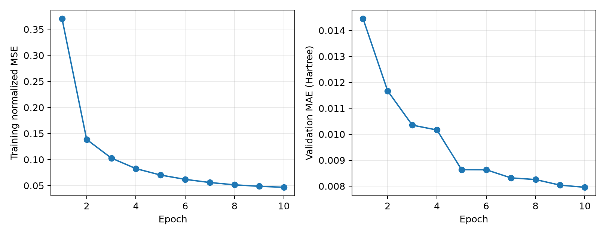

# SPE + Transformer：10-epoch 实现诊断

## 检查逻辑

“比论文结果差，因此实现正确”不成立。实现有错误也可能得到更差的结果；实现正确也可能因为
任务更容易、数据不同或训练设置不同而得到更好的指标。性能高低是排查线索，不是正确性判据。

本次为 QM9 delta_e 单 seed 短训练，不能判定是否复现论文结果，也不能判定 SPE 是否稳定优于
原子级 Transformer；后者需要同划分、同预算的多 seed 对照。

## 与原论文的可比性

依据本地 Li and Fourches (2021) 论文，DOI `10.1021/acs.jcim.0c01127`：

| 项目 | 原论文 | 本次实验 |
| --- | --- | --- |
| 回归任务 | 24 个蛋白靶标的 pIC50，§2.2、Table 1 | QM9 HOMO–LUMO gap，delta_e |
| 标签尺度 | pIC50 | Hartree |
| 模型 | AWD-LSTM/MolPMoFiT，§2.5.3–2.5.5 | 4 层 Transformer，hidden 256，8 heads |
| 预训练 | 化学语言模型预训练及下游微调 | 从头训练 |
| 划分 | 10 次随机 80:10:10 划分 | 现有分位分层固定划分 3407，80:10:10 |
| SMILES 增广 | 训练、验证和测试增广，§2.5.5 | 无 |
| SPE 语料 | ChEMBL，约 340 万 SMILES | 仅 107038 条 QM9 训练 SMILES |
| 分词长度 | ChEMBL 的 SPE 平均约 6 tokens，§3.1/Fig.3 | 本数据训练集平均约 3.665 tokens |
| 训练轮数 | 文中 10 epochs 指语言模型训练；QSAR 轮数由验证集调节 | 本次直接回归训练 10 epochs |

因此不能把原论文的 pIC50 MAE/RMSE 与本次 Hartree MAE/RMSE 直接比较；即使指标都叫 R²，
跨数据集的数值也不能用于验收实现。平均分词长度不同也不意味着实现错误。

## 本次协议

- 配置：`configs/spe_transformer_10epoch.yaml`。
- 输出：`outputs/spe_transformer_10epoch/seed3407/`。
- 除实验名和 `epochs: 10` 外，与正式 SPE 配置相同；不覆盖正式运行产物。
- 选模依照验证 MAE，测试集只在训练完成后评估最佳 checkpoint。
- warmup/cosine 根据总 steps 计算，因此 10 epochs 的调度会压缩到 10 轮，
  并非 100-epoch 正式实验的前 10 轮。
- 常数基线仅使用训练集均值/中位数，在完全相同的测试集评估。
- 10-epoch 结果只能用于初步诊断，不根据这一次测试结果调整 SPE 超参数。

## 独立的小样本拟合检查

使用固定随机种子抽取 16 条训练样本，保持网络层数和宽度；诊断时关闭 dropout、权重衰减，
采用恒定学习率 3e-4，在 CPU 更新 200 步。归一化 MSE 从约 0.963 降至约 4.94e-11。
说明该网络和 SPE 编码能拟合小训练集，支持梯度及损失链路正常；它不是泛化能力指标。
完整样本 ID、诊断设置与损失轨迹保存在 `tiny_overfit.json`。

## 实验结果

训练完成 10 epochs，训练耗时 18.68 分钟；测试样本 13380。

| 方法 | MAE (Hartree) | RMSE (Hartree) | MAPE (%) | R² |
| --- | ---: | ---: | ---: | ---: |
| Training mean | 0.03962738 | 0.04746837 | 16.8733 | -0.000000 |
| Training median | 0.03960662 | 0.04749588 | 16.7549 | -0.001160 |
| SPE + Transformer (10 epochs) | 0.00785194 | 0.01109081 | 3.3355 | 0.945409 |

测试 MAE 相对训练均值基线降低 80.19%。最佳验证 MAE 为 0.00795744 Hartree，来自第 10 轮。



## 实现检查结论

- 分词器来自官方实现，安装源码与核查仓库一致；已有专项测试覆盖完整分词、未知 token、训练集隔离、保存恢复。
- 全量划分身份校验通过；本次预测 CSV 的 sample_id、SMILES、真实标签和顺序与原测试集一致；预测均为有限值。
- 从预测 CSV 重算的 MAE/RMSE/MAPE/R² 与训练输出一致。
- 用保存的 model.pt 在同一 GPU、相同 batch size 重算全部 13380 条测试预测，与 CSV 最大差异为 5e-11 Hartree（CSV 舍入量级）。
- CPU 上抽查 64 条预测与原 CUDA 预测的最大差异为 6.17e-06 Hartree。最初 1e-6 的跨设备检查阈值未通过；同设备全量复核通过，说明这里存在跨设备浮点计算差异，而非模型保存恢复不一致。
- 16 条训练样本拟合诊断通过；正式短跑训练损失和验证 MAE 总体下降。

**这些结果支持当前实现的训练、分词、保存及评估链路正常，未发现上述检查覆盖范围内的错误；不能据此证明没有任何 bug，也不是原论文复现。**

若要进一步检验 SPE 的效果，需要在本项目相同划分和训练预算下，与原子级 Transformer 完成多个 seed 的受控对照。不能使用“低于原论文”作为验收标准。

## 复核命令

从项目根目录执行；审计脚本要求原训练 CUDA 设备：

```bash
uv run molgap-train-transformer --config configs/spe_transformer_10epoch.yaml
uv run python reports/spe_transformer/10epoch/audit_run.py
```

本次训练产物已经存在，重复训练默认拒绝覆盖。不要为重复审计而重新训练。
